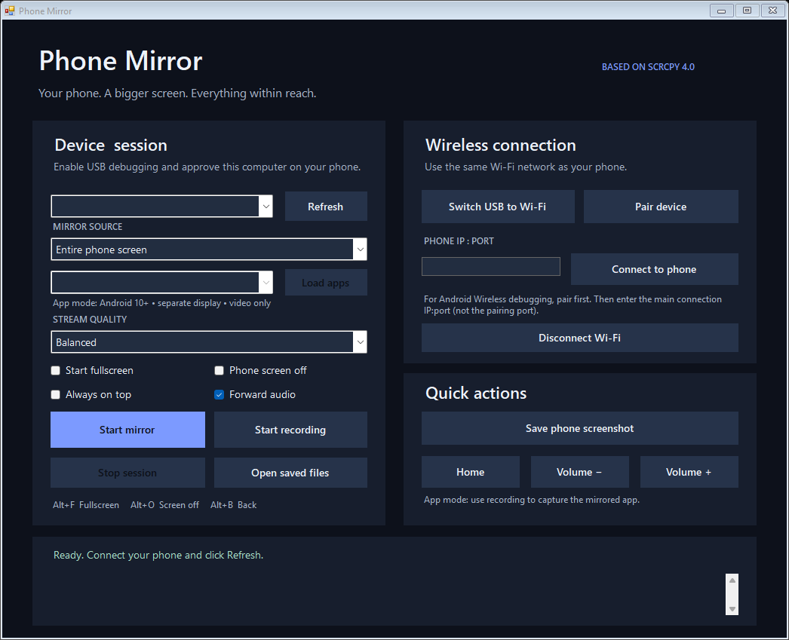

# Phone Mirror Control Panel

**A portable Windows control panel based on [scrcpy](https://github.com/Genymobile/scrcpy) by Genymobile and Romain Vimont.**

This project adds a native C# Windows desktop interface around scrcpy 4.0. Screen mirroring, audio forwarding, recording, and Android control are provided by scrcpy and Android Debug Bridge (ADB). This is an independent launcher, not an official Genymobile product. The bundled scrcpy executables are unchanged.



## Start

1. Download or clone this whole project to a writable folder on a Windows 64-bit PC. Extract ZIP downloads first.
2. Double-click **Phone Mirror.exe**.
3. Enable Android Developer options and USB debugging. Connect with a data cable, unlock the phone, and approve the debugging prompt.
4. Click **Refresh**, select the device, then **Start mirror**.

scrcpy and its runtime files are included in `vendor/scrcpy`. You do not need a separate scrcpy installation or a fixed Desktop path. The native launcher uses .NET Framework 4.8, included on supported Windows 10/11 installations. Running it does not require CMD or PowerShell. Android 5.0+ supports screen mirroring; audio forwarding requires Android 11+ and depends on app restrictions. Managed PCs may restrict PowerShell or device debugging.

## Features

- Device selection and USB connection status with troubleshooting messages.
- Wireless pairing, saved connection address, and USB-to-Wi-Fi setup.
- Sharp, Balanced, and Low delay presets.
- Fullscreen, phone screen off, always on top, and audio options.
- Recording to MKV and screenshots to PNG.
- Home and volume buttons, shortcut reminders, and session logs.

### Wireless connection

Use the same network as your phone. With a selected USB device, **Switch USB to Wi-Fi** enables TCP/IP and starts mirroring. Refresh afterward to find the network device.

For Android 11+ Wireless debugging, open **Pair device with pairing code** on the phone. Use its pairing IP:port and six-digit code in **Pair device**. Then enter the main Wireless debugging IP:port in the panel and click **Connect to phone**. The pairing and connection ports differ.

Disconnect Wi-Fi closes the selected ADB connection. After USB-to-Wi-Fi setup, reboot the phone to disable its TCP/IP listening mode. For Wireless debugging, turn the setting off on the phone when finished.

### Presets

| Preset | Maximum video size | Bit rate | FPS cap |
|---|---:|---:|---:|
| Sharp | 1920 pixels | 12 Mbps | 60 |
| Balanced | 1280 pixels | 8 Mbps | 60 |
| Low delay | 1024 pixels | 4 Mbps | 60 |

These are limits, not performance guarantees. Low delay adds no extra video buffer. Options apply when starting a session.

### Recording and screenshots

**Start recording** begins a new mirroring session. **Stop session** closes the mirror gracefully and finalizes the recording. Changing recording mode requires a new session. Avoid force-killing a recording process.

**Save screenshot** captures the selected device using ADB, including when no mirror is running. **Open saved files** opens `%LOCALAPPDATA%\PhoneMirror\Saved`. This folder contains recordings, screenshots, and the last address/preset. New native settings use `settings.xml`; older PowerShell settings are not migrated automatically. Pairing codes are not saved. `Saved/` is excluded from Git and release archives.

### Mirror shortcuts

| Shortcut | Action |
|---|---|
| Alt+F or F11 | Toggle fullscreen |
| Alt+O | Phone screen off, keep mirroring |
| Alt+Shift+O | Phone screen on |
| Alt+B | Back |
| Alt+H | Home |
| Alt+Up / Alt+Down | Volume |

## Troubleshooting

- **Unauthorized:** unlock the phone and accept the USB debugging prompt.
- **Offline / no device:** reconnect, try a data-capable cable, then Refresh.
- **Wi-Fi connection failure:** verify the network, current IP, and connection port. USB-to-Wi-Fi setup may need repeating after a reboot.
- **Audio fails:** disable Forward audio and start again.
- **An operation fails:** read the activity log. scrcpy output is shown when the session ends.

## Attribution and licenses

This project is based on scrcpy. Credit for the mirroring engine belongs to **Genymobile, Romain Vimont, and scrcpy contributors**.

- Official project: https://github.com/Genymobile/scrcpy
- Included upstream version: https://github.com/Genymobile/scrcpy/releases/tag/v4.0
- scrcpy license: Apache License 2.0.
- The new launcher code is also distributed under Apache License 2.0; this does not change any bundled component's license.

See [NOTICE](NOTICE), [THIRD-PARTY.md](THIRD-PARTY.md), and `licenses/` for dependency notices. Source archives for scrcpy, FFmpeg, libusb, and dav1d are included under `third-party-source/`. The scrcpy source archive contains the upstream build scripts and dependency configuration.

The official Windows archive was checked against the upstream SHA-256 list. `vendor/scrcpy/FILES-SHA256.csv` records the included runtime file hashes.

## Development and validation

The control panel source is `src/PhoneMirror.cs`. The executable calls scrcpy and ADB directly using Windows process APIs. Its manifest requests current-user privileges, with no administrator elevation. It is not a PowerShell wrapper. The executable is unsigned; Windows may display an unknown-publisher warning. A checksum confirms file integrity, not publisher identity.

```powershell
& '.\Phone Mirror.exe' --validate
& '.\Phone Mirror.exe' --smoke-test
```

The smoke test creates `UI-preview.png` and closes the window. It checks UI construction, not a live Android session. Actual USB/Wi-Fi mirroring, audio, and recording require a connected phone and have not been verified end to end for this launcher.

Developers can build the native executable using the Windows .NET Framework compiler:

```powershell
powershell.exe -NoProfile -ExecutionPolicy Bypass -File .\scripts\Build-Native.ps1
```

To build a clean portable ZIP:

```powershell
powershell.exe -NoProfile -ExecutionPolicy Bypass -File .\scripts\Build-Release.ps1
```

## Publish to GitHub

This folder is the repository root. Choose an empty GitHub repository and push the local `main` branch:

```powershell
git remote add origin https://github.com/YOUR-USERNAME/phone-mirror-control-panel.git
git push -u origin main
```

The v1.1.0 portable release includes the native executable and runtime, and omits optional upstream BAT/VBS launchers and developer build scripts. Source code and build scripts remain available in this repository. The runtime binaries are tracked because this repository is intentionally a complete portable bundle. Individual files are below GitHub's 100 MiB file limit. Keep generated ZIPs in GitHub Releases rather than committing them.
